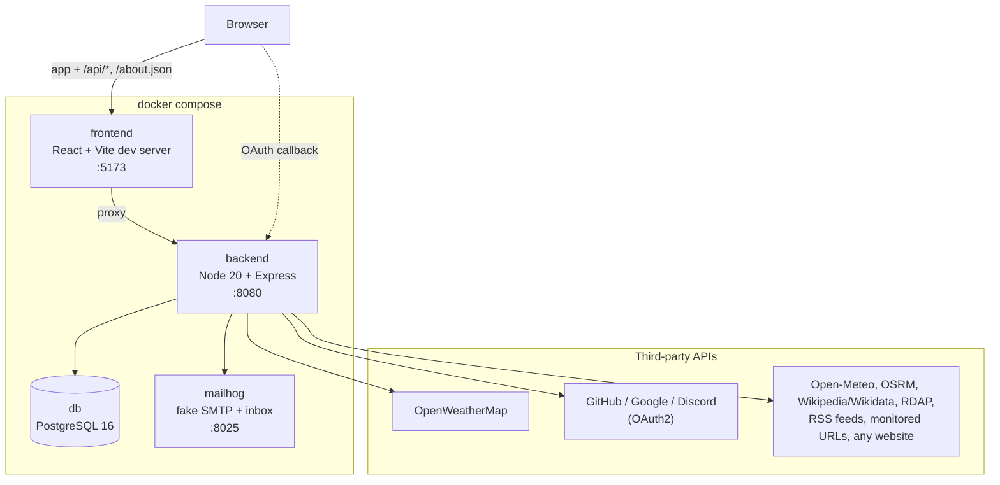

# Project architecture

The big picture: what runs, how the pieces fit, who owns what, and where to read more. Each part
has its own detailed document:

| Document                                                                    | What it covers                                                                 |
| --------------------------------------------------------------------------- | ------------------------------------------------------------------------------ |
| [BACKEND.md](./BACKEND.md)                                                  | The API: layers, authentication, password hashing, OAuth2, widgets and refresh on the server, data model, configuration |
| [FRONTEND.md](./FRONTEND.md)                                                | The app: routes, session, dashboard, the refresh Timer, widget system, themes, app shell |
| [FRONTEND_BACKEND_COMMUNICATION.md](./FRONTEND_BACKEND_COMMUNICATION.md)    | The contract between them: network path, endpoints, status codes, end-to-end flows |
| [DATABASE_SCHEMA.md](./DATABASE_SCHEMA.md)                                  | The database: diagram, every column, constraints, indexes, JSON contents, migrations |
| [SERVICES_AND_WIDGETS.md](./SERVICES_AND_WIDGETS.md)                        | Every service and widget with its exact parameters and setup                   |
| [DECISIONS.md](./DECISIONS.md)                                              | Why things are built the way they are, and what each choice costs              |
| [STACK.md](./STACK.md), [STACK_COMPARISON.md](./STACK_COMPARISON.md), [TECH_POC.md](./TECH_POC.md), [BENCHMARK.md](./BENCHMARK.md) | The stack, its alternatives, the proofs of concept and the measured performance |
| [POC.md](./POC.md)                                                          | Riskier designs proved before building on them                                 |

## Overview

A monorepo (**npm workspaces** `backend` and `frontend`) started by a single `docker-compose.yml`.
Four containers at runtime:

- The browser only talks to the frontend container, whose dev server also proxies `/api/*` and
  `/about.json` to the backend.
- The backend is the only component holding secrets (JWT secret, OAuth client secrets, the
  credentials encryption key) and the only one calling third-party APIs; users' linked-account
  tokens never reach the browser.
- `GET /about.json` describes the server and its whole catalog of services and widgets — the
  contract required by the brief. It is generated from the backend's widget registry, so it always
  matches what's installed (currently **11 services, 37 widgets**, `notes` included).

## How a widget works, end to end

This is the core of the project, and it crosses every layer:

1. **Catalog.** A service declares its widgets and their parameters in the backend
   (`<service>/catalog.js`); they appear in `/about.json`.
2. **Instance.** A user picks a widget in the "Add a widget" form (built from `/about.json`), fills
   its config, size and refresh rate; the backend validates it against the catalog and stores a
   `WidgetInstance`.
3. **Timer.** In the browser, the widget's card fetches `GET /api/dashboard/widgets/:id/data`
   immediately, then every `refreshRate` seconds.
4. **Provider.** For each call, the backend loads the instance and the user's decrypted credentials
   for that service, and calls the service's provider in-process, which queries the third-party
   API (with retries on network failures).
5. **Display.** The card renders the result with that widget's `Display` component; an error only
   affects that card.

## Work split

The project was organized in two parts; the git history is the authoritative record of who did
what.

| Part                          | Owner           | Scope                                                                                                     |
| ----------------------------- | --------------- | --------------------------------------------------------------------------------------------------------- |
| Part 1 — Content & Widgets    | DEGNON Kimberly | Services weather, GitHub, RSS, monitoring, maps, YouTube and their widgets and the shared `WidgetFrame`; service subscription; the generic OAuth2 flow and encrypted credentials; network resilience; Theme page and wallpapers; floating app shell; profile editing, account deletion, editing a widget's type; GDPR notice |
| Part 2 — Identity & Infra     | ALAO Olaife     | Accounts (register, confirmation email, login, JWT); the widget registry and `/about.json`; dashboard CRUD, drag and resize; the refresh Timer; public sharing; administration; theme system and sidebar; services Pinterest, notes, calendar, clock, website; Docker, CI |

The [Prisma schema](../backend/prisma/schema.prisma) mirrors the original boundary: Part 1 owns
`ServiceSubscription`, Part 2 owns `User` and `WidgetInstance`.

## Infrastructure

- **`docker-compose.yml`** — `db` (PostgreSQL 16, persistent volume), `mailhog`, `backend` (applies
  database migrations on start, port 8080), `frontend` (Vite dev server, port 5173). Every variable
  has a default, so `docker compose up --build` works with no `.env`; real API keys and OAuth apps
  go in `.env` (template: `.env.example`).
- **Images** copy the source at build time (no bind mount): rebuild after changing code.
- **CI** (`.github/workflows/ci.yml`) — on every push and pull request to `main`/`develop`: install,
  lint, backend tests, then build the images, boot the stack and check that `/health` answers.
- **Git hooks** — Husky + lint-staged run ESLint/Prettier on commit.
- **`.dockerignore`** — keeps `node_modules`, `.git` and design references out of the build context.

## Data model

Three tables (full schema, diagram and indexes in [DATABASE_SCHEMA.md](./DATABASE_SCHEMA.md)):

- **`User`** — account, bcrypt password hash, role (`USER`/`ADMIN`), confirmation status and token,
  optional public share token.
- **`ServiceSubscription`** — one row per user and service; for OAuth services, the linked
  account's tokens, encrypted.
- **`WidgetInstance`** — a widget on a user's dashboard: which service and widget, its config,
  refresh rate, size and position.

Deleting a user cascades to both of the other tables.
