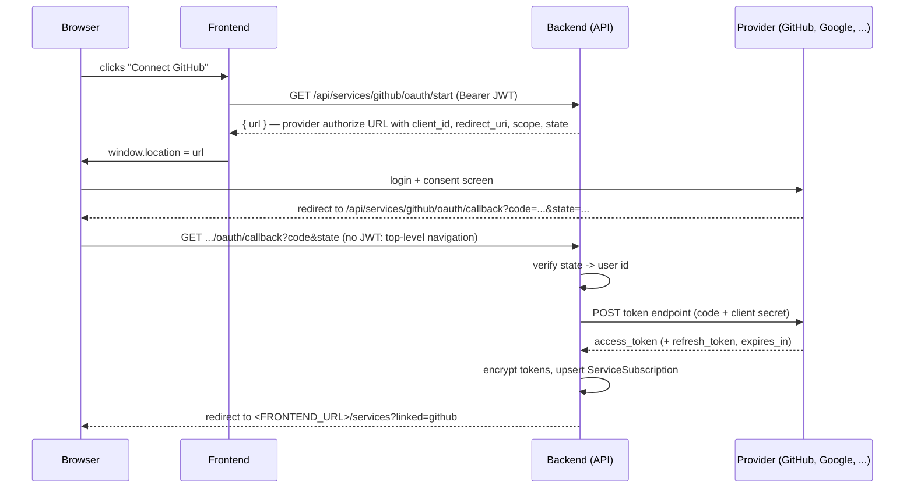
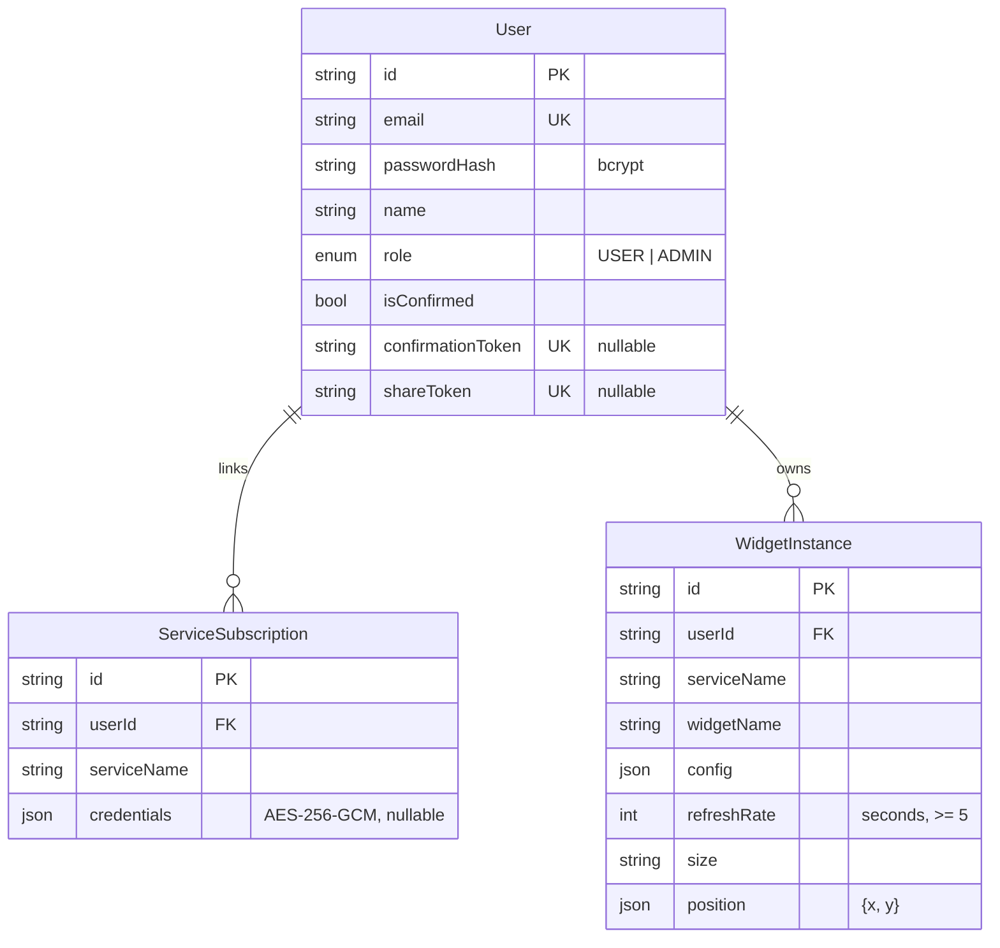

# Backend

The REST API behind the dashboard: accounts, the widget catalog (`GET /about.json`), widget
instances and their live data, linked third-party accounts (OAuth2), public sharing and
administration. How the frontend talks to it is covered in
[FRONTEND_BACKEND_COMMUNICATION.md](./FRONTEND_BACKEND_COMMUNICATION.md); the big picture is in
[ARCHITECTURE.md](./ARCHITECTURE.md).

## Stack

| Concern               | Choice                                       |
| --------------------- | -------------------------------------------- |
| Runtime               | Node.js 20 (Docker image `node:20-alpine`)   |
| HTTP framework        | Express 4                                    |
| Database / ORM        | PostgreSQL 16 through Prisma 5               |
| Password hashing      | `bcryptjs`                                   |
| Sessions              | Stateless JWT (`jsonwebtoken`)               |
| Input validation      | `express-validator` (routes) + service-level checks |
| Outbound HTTP         | `axios`, wrapped in a retry helper           |
| Email                 | `nodemailer` over SMTP (MailHog by default)  |
| Tests                 | Jest + Supertest, Prisma mocked              |

Why these and not the alternatives: [STACK_COMPARISON.md](./STACK_COMPARISON.md),
[TECH_POC.md](./TECH_POC.md), [BENCHMARK.md](./BENCHMARK.md), [DECISIONS.md](./DECISIONS.md).

## Folder layout

```
backend/
  prisma/
    schema.prisma            // User, ServiceSubscription, WidgetInstance
    migrations/              // applied automatically on container start (prisma migrate deploy)
  src/
    index.js                 // entry point: DNS order fix, then starts the HTTP listener
    app.js                   // middleware chain + route mounting + service definitions loading
    config/
      env.js                 // every environment variable, with defaults
      prisma.js              // shared Prisma client
    middleware/
      auth.js                // requireAuth (JWT -> req.user), requireAdmin
      errorHandler.js        // single JSON error format, 404 fallback
    routes/                  // URL + validation rules, nothing else
    controllers/             // HTTP in/out: read the request, call a service, shape the response
    services/
      authService.js         // register, confirm, login, update/delete own account
      dashboardService.js    // widget instances CRUD, live data, sharing
      widgetRegistry.js      // in-memory catalog behind GET /about.json
      loadDefinitions.js     // auto-registers every file in services/definitions/
      providerRegistry.js    // fetchWidgetData(service, widget, config, credentials)
      credentialsStore.js    // decrypt + transparently refresh linked-account tokens
      crypto.js              // AES-256-GCM encryption of stored credentials
      httpClient.js          // withRetry(): retries transient network failures
      mailer.js              // confirmation emails
      definitions/<svc>.js   // one line per service: registerService(name, catalog)
      <service>/             // weather, github, rss, monitoring, maps, youtube,
        catalog.js           //   discord, notes, calendar, clock, website
        client.js            // the actual HTTP calls to the third-party API
        provider.js          // widget name -> client function
        oauth.js             // only for OAuth services
  tests/                     // one file per route/service module
```

Each layer only talks to the one below it: **route** (URL, validation) → **controller** (HTTP) →
**service** (rules, Prisma, providers). Controllers never touch Prisma directly, and services never
see `req`/`res`.

## Request lifecycle

`src/index.js` first calls `dns.setDefaultResultOrder('ipv4first')` (see
[Outbound calls](#outbound-calls-to-third-party-apis)), then starts the server built in `app.js`,
which applies, in order:

1. `cors({ origin: FRONTEND_URL })` — only the configured frontend origin may call the API from a
   browser.
2. `express.json()` — JSON request bodies.
3. `morgan('dev')` — one log line per request (method, path, status, duration). Skipped in tests.
   It does not log IP addresses or bodies.
4. The routers: `/health`, `/about.json`, `/api/auth`, `/api/dashboard`, `/api/services`,
   `/api/admin`, `/api/public`.
5. `notFoundHandler` (JSON 404), then `errorHandler`.

### Errors

Every error leaves the API as `{ "error": "<message>" }`. Services throw an `Error` carrying a
`status`; the error handler uses it, and anything without one becomes a 500 whose message is
replaced by `Internal server error` (the real error is only logged server-side). Status codes are
used consistently:

| Code | Meaning in this API                                                                      |
| ---- | ---------------------------------------------------------------------------------------- |
| 400  | Invalid input (validation, bad config for a widget, nothing to update)                    |
| 401  | **Only** this API's own authentication failed (missing, invalid or expired JWT)           |
| 403  | Authenticated but not allowed (not admin, wrong password on a sensitive action, unconfirmed email at login) |
| 404  | Unknown resource, or a resource owned by another user                                    |
| 409  | Conflict (email already used, deleting the last admin)                                   |
| 424  | A third-party provider rejected the request (e.g. account not linked, revoked token)     |

401 is reserved on purpose: the frontend treats any 401 as "your session is over" and logs the
user out, so nothing else may return it — which is why a wrong password is a 403 and a provider
auth failure is remapped from 401 to 424 (see [DECISIONS.md](./DECISIONS.md)).

## Authentication

### Registration and email confirmation

`POST /api/auth/register` validates the input (valid email, normalized; password of at least 8
characters; non-empty name), rejects an email already in use (409), hashes the password (below),
generates a random 32-byte confirmation token and stores the account with `isConfirmed = false`.
The role is `ADMIN` only if the email is listed in `ADMIN_EMAILS` — there is no other way to create
the first admin. A confirmation link (`<FRONTEND_URL>/confirm/<token>`) is emailed; if the mail
server is unreachable, registration still succeeds and the link is logged instead.
`GET /api/auth/confirm/:token` marks the account confirmed and deletes the token (single use).

### How passwords are hashed

Passwords are never stored, logged or returned — only a **bcrypt hash** is kept, in
`User.passwordHash`.

- **One-way.** bcrypt is a hashing function, not encryption: there is no key that turns the hash
  back into the password. The only way to check a password is to hash the candidate the same way
  and compare the results.
- **A random salt per password.** Every call to `bcrypt.hash(password, 10)` draws a new random
  16-byte salt. Two users with the same password therefore get completely different hashes, and
  precomputed "rainbow tables" are useless. The salt is not secret and is stored inside the hash
  string itself (spaces added below for readability):

  ```
  $2a$10$N9qo8uLOickgx2ZMRZoMye IjZAgcfl7p92ldGxad68LJZdL17lhWy
  └┬┘└┬┘ └──────── salt ───────┘└────────────── hash ─────────────┘
   │  └ cost factor (2^10 rounds)
   └ algorithm version
  ```

- **Deliberately slow.** The cost factor (`SALT_ROUNDS = 10` in `authService.js`) means 2¹⁰ = 1024
  rounds of key expansion, so one hash takes a few tens of milliseconds. Invisible for a login,
  but it makes brute-forcing a stolen database orders of magnitude more expensive than with a
  fast, general-purpose hash like SHA-256. The factor is written in each hash, so it can be raised later without
  invalidating existing passwords.
- **Verification.** At login, `bcrypt.compare(candidate, passwordHash)` reads the salt and cost
  from the stored hash, re-hashes the candidate with them, and compares in constant time.
- **Limit.** bcrypt only uses the first 72 bytes of a password; the 8-character minimum is far
  below that.

The same `compare` protects every sensitive self-service action (changing email or password,
deleting the account), and changing the password simply stores a brand-new hash with a new salt.

### Login and sessions (JWT)

`POST /api/auth/login` answers `Invalid email or password` (401) whether the email is unknown or
the password is wrong, so it can't be used to discover which emails have an account. An
unconfirmed account gets a 403. On success it returns a **JWT** signed with `JWT_SECRET` (HS256),
containing `sub` (user id) and `role`, valid for `JWT_EXPIRES_IN` (default `7d`).

There is no server-side session. `requireAuth` reads `Authorization: Bearer <token>`, verifies the
signature and expiry, then **reloads the user from the database** on every request — so a deleted
account stops working immediately (`User no longer exists`), and `requireAdmin` checks the role
from the database, never the one written in the token. The trade-off of stateless tokens: an
issued token can't be revoked before it expires (changing the password does not log out other
devices).

### Self-service account management

| Endpoint                  | Rules                                                                                     |
| ------------------------- | ----------------------------------------------------------------------------------------- |
| `GET /api/auth/me`        | The current user (`id`, `email`, `name`, `role` — never the hash)                         |
| `PATCH /api/auth/me`      | Name: free. Email or password: current password required (403 if wrong). A new email must not be in use (409) and must be confirmed again: `isConfirmed` goes back to false and a new link is sent to the new address — the current session keeps working, the next login needs the confirmation |
| `DELETE /api/auth/me`     | Current password required (403 if wrong); the last remaining admin can't delete themselves (409). The user's subscriptions (with their tokens) and widgets are deleted by database cascade |

## Linked accounts: OAuth2

GitHub, YouTube (Google) and Discord data is read **on behalf of the user**, with their
own account. The backend implements the OAuth2 **Authorization Code** flow by hand (no Passport):



Step by step:

1. **Start** — `GET /api/services/:service/oauth/start` is authenticated, so it can't be a plain
   link (a browser navigation can't carry the `Authorization` header). The frontend calls it with
   axios, gets `{ url }` back, and navigates to it.
2. **`state`** — the authorize URL carries a `state` parameter: a JWT signed with the server's
   secret, containing the user id and expiring after 10 minutes. It does two jobs. It tells the
   callback *which* user is linking an account without any server-side session, and it prevents
   CSRF: a callback with a forged or foreign `state` fails signature verification (400).
3. **Consent** — the user signs in on the provider's own site; the dashboard never sees their
   provider password. Declining sends them back with `?error=...`, which the callback turns into
   a redirect to the Services page instead of a raw error.
4. **Code exchange** — the callback receives a short-lived, single-use `code` and exchanges it,
   server to server, together with the app's client secret (never exposed to the browser):

   | Provider  | Scopes                                        | Client authentication     | Token lifetime / refresh                         |
   | --------- | --------------------------------------------- | ------------------------- | ------------------------------------------------ |
   | GitHub    | `repo read:user`                              | `client_secret` in body   | Non-expiring unless the app enables expiring tokens |
   | YouTube   | `youtube.readonly`                            | `client_secret` in body   | ~1 h; refresh token forced with `access_type=offline` + `prompt=consent` |
   | Discord   | `identify guilds`                             | HTTP Basic (`id:secret`)  | ~7 days, refresh token (rotated on refresh)       |

5. **Storage** — the result is normalized to `{ accessToken, refreshToken, expiresAt }` and stored
   in `ServiceSubscription.credentials`, **encrypted at rest** with AES-256-GCM (`crypto.js`): a
   32-byte key from `CREDENTIALS_ENCRYPTION_KEY`, a fresh random 12-byte IV per encryption, and
   the GCM authentication tag, so a tampered ciphertext fails to decrypt instead of producing
   garbage. A database leak alone does not leak usable tokens.
6. **Use and refresh** — when a widget needs data, `credentialsStore.loadCredentials` decrypts the
   tokens; if `expiresAt` is past and a refresh token exists, it calls that provider's
   `refreshAccessToken`, re-encrypts and saves the new tokens, then continues — invisible to the
   user. If a provider doesn't return a new refresh token, the previous one is kept.
7. **Failure** — a widget of an unlinked service, or a provider rejecting the token, raises a 401
   inside the provider, remapped to **424** before leaving the API.

Every OAuth module exposes the same four functions (`buildAuthorizeUrl`, `verifyState`,
`exchangeCodeForToken`, `refreshAccessToken`). Registering one in `OAUTH_PROVIDERS`
(`services.controller.js`) is enough to get both routes, mark the service `requiresAuth` in
`GET /api/services`, and forbid subscribing to it without the OAuth flow. Provider-specific
setup (callback URLs, Google test users) is in
[SERVICES_AND_WIDGETS.md](./SERVICES_AND_WIDGETS.md).

## Widgets and their data

- **Catalog.** Each service declares its widgets' metadata (`name`, `description`, `params` with
  `string`/`integer` types) in `<service>/catalog.js`; `definitions/<service>.js` registers it at
  startup. `GET /about.json` serves the registry as-is, with the caller's IP and the server time
  — the exact contract of the project brief. On the backend, adding a service only touches shared
  code in `providerRegistry.js` (plus `OAUTH_PROVIDERS` and `credentialsStore.js` for an OAuth
  service).
- **Instances.** `WidgetInstance` rows (per user) are created and edited through
  `/api/dashboard/widgets`. Every write is re-validated against the registry: the widget must
  exist, every declared param must be present with the right type, `refreshRate` must be an
  integer ≥ 5, `size` one of `square`/`wide`/`tall`/`large`. An update may also change the
  widget's service and type; the config is then validated against the *new* widget.
- **Live data.** `GET /api/dashboard/widgets/:id/data` loads the instance (404 if it belongs to
  someone else), the user's decrypted credentials for that service, and calls
  `providerRegistry.fetchWidgetData`, which dispatches to `<service>/provider.js` → `client.js`,
  in the same process (no internal HTTP hop). It returns `{ data, fetchedAt }`.

### Refresh rate (server side)

Each instance stores its own `refreshRate` (seconds, integer, minimum 5, validated on create and
update). The backend has **no scheduler**: it is pull-based. The frontend calls the data endpoint
of each widget every `refreshRate` seconds (see [FRONTEND.md](./FRONTEND.md#refresh-rate-the-timer)),
and every call triggers a fresh request to the third-party API — there is no cache. The refresh
rate is therefore exactly the rate at which that widget hits its provider, which is why a floor
of 5 seconds is enforced on the server and not just in the form: a hand-crafted request can't set
a widget to hammer a third-party API.

### Outbound calls to third-party APIs

- **Retries.** Every provider client wraps its calls in `withRetry` (`httpClient.js`): up to 2
  retries, 250 ms then 500 ms apart, but only for network-level failures (`ETIMEDOUT`,
  `ECONNRESET`, `ECONNREFUSED`, `ENETUNREACH`, `EAI_AGAIN`). A real HTTP answer (401, 404, ...)
  is returned immediately. `monitoring` deliberately doesn't retry — hiding failures would defeat
  its purpose.
- **IPv4 first.** The Docker network has no IPv6 route, and Node could try a host's IPv6 address
  first, failing intermittently; `index.js` makes DNS return IPv4 addresses first.
- **User-chosen URLs (SSRF).** The website overview widget makes the server fetch a URL typed by
  a user. `website/publicUrl.js` refuses any address in a private, loopback, link-local or
  cloud-metadata range — checked on the resolved IPs at connection time (so redirects and DNS
  tricks are covered too), with size, redirect and time limits. Rarely-changing, rate-limited
  sources (Wikipedia/Wikidata, RDAP) are cached in memory so a short refresh rate doesn't hammer
  them.

## Public sharing

`POST /api/dashboard/share` generates a random 24-byte `shareToken` on the user (idempotent),
`DELETE` clears it and immediately kills the link. `GET /api/public/dashboards/:token` needs no
authentication — the unguessable token stands in for a session — and returns the owner's name and
widgets with live data fetched through the same pipeline. One failing widget returns its own
`error` without breaking the others.

## Administration

`/api/admin/users` (requireAuth + requireAdmin): list users, change a role, delete a user. An admin
can't change their own role or delete their own account from there (lockout protection).

## Email

`mailer.js` sends through the SMTP server in `SMTP_HOST`/`SMTP_PORT` — by default the `mailhog`
container, a fake SMTP server with a web inbox at `http://localhost:8025`, so confirmation works
with zero setup. Port 465 uses implicit TLS; other ports upgrade with STARTTLS when available.

## Data model



`(userId, serviceName)` is unique on `ServiceSubscription`. Both relations are `onDelete: Cascade`,
which is what makes account deletion complete in a single query. Every column, constraint, index
and JSON shape is detailed in [DATABASE_SCHEMA.md](./DATABASE_SCHEMA.md).

## Configuration

All variables are read in `src/config/env.js`, with defaults that make `docker compose up` work
without any `.env`. The templates are `.env.example` (Docker) and `backend/.env.example` (running
the backend directly).

| Variable                          | Used for                                                  |
| --------------------------------- | --------------------------------------------------------- |
| `DATABASE_URL`                    | PostgreSQL connection                                     |
| `JWT_SECRET`, `JWT_EXPIRES_IN`    | Signing sessions and OAuth `state`; session lifetime       |
| `FRONTEND_URL`                    | CORS origin, OAuth and confirmation redirects             |
| `CREDENTIALS_ENCRYPTION_KEY`      | 32-byte hex key for linked-account tokens                 |
| `ADMIN_EMAILS`                    | Emails promoted to admin at registration                  |
| `OPENWEATHER_API_KEY`             | Weather service                                           |
| `GITHUB_*`, `YOUTUBE_*`, `DISCORD_*` | OAuth apps: client id, secret, callback URL |
| `SMTP_*`, `MAIL_FROM`             | Outgoing email                                            |

## Tests

```bash
npm test -w backend
```

One Jest file per route or service module; HTTP routes are exercised with Supertest against the
real Express app, with Prisma, the mailer and outbound HTTP mocked so the suite runs offline in a
few seconds. It covers validation, ownership checks, status codes (including the 401/403/424
rules above), password hashing and comparison, OAuth `state` and token handling, encryption, and
every widget provider.
