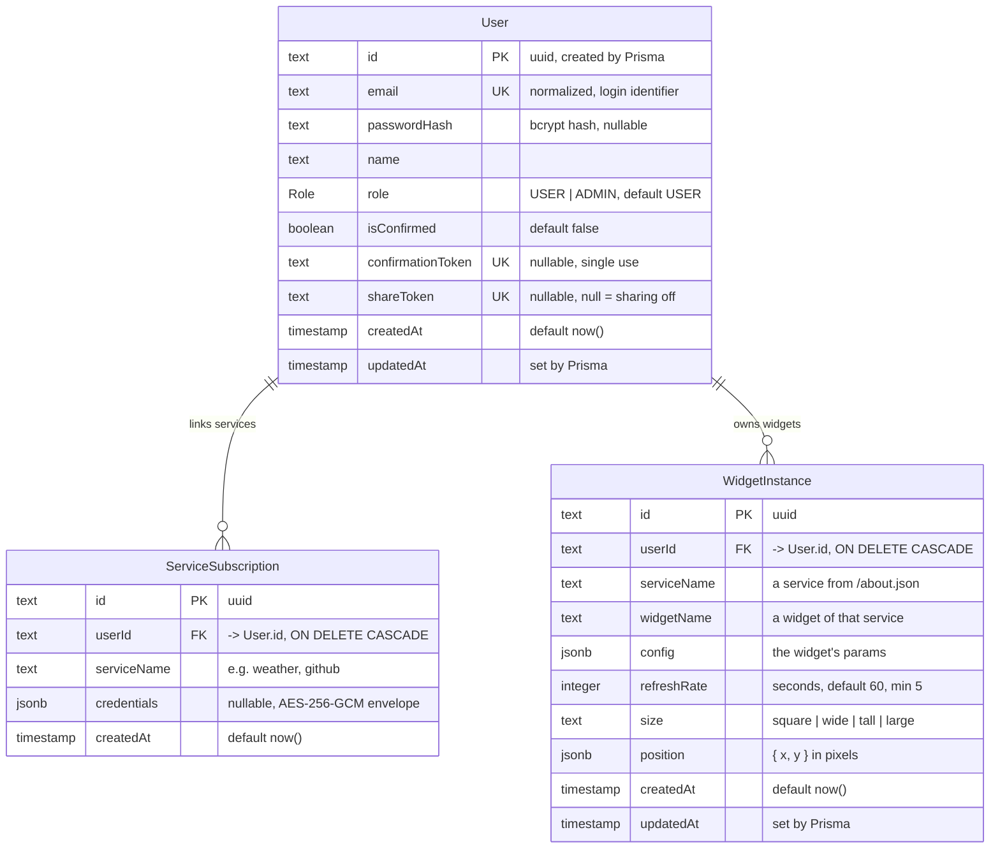

# Database schema

The PostgreSQL 16 database behind the dashboard: three tables, one enum. The source of truth is
[`backend/prisma/schema.prisma`](../backend/prisma/schema.prisma); the SQL actually applied lives in
[`backend/prisma/migrations/`](../backend/prisma/migrations). Everything below was checked against
the running database (`pg_indexes`, `information_schema.columns`), not only against the Prisma
file. How the backend uses these tables is in [BACKEND.md](./BACKEND.md).

## Diagram



Relations: a user has **0..n** subscriptions and **0..n** widget instances; each subscription and
each widget belongs to exactly one user. There is no table for services or widgets themselves: the
catalog lives in the backend's code (see [Why the catalog is not in the database](#why-the-catalog-is-not-in-the-database)).

## Tables

### `User`

One row per account.

| Column              | Type            | Null | Default         | Notes                                                                 |
| ------------------- | --------------- | ---- | --------------- | --------------------------------------------------------------------- |
| `id`                | `text`          | no   | Prisma `uuid()` | Primary key                                                           |
| `email`             | `text`          | no   |                 | **Unique**; normalized at registration; used to log in                |
| `passwordHash`      | `text`          | yes  |                 | bcrypt hash (`$2a$10$…`), never the password. Nullable in the schema, always set by registration |
| `name`              | `text`          | no   |                 | Display name                                                          |
| `role`              | `Role` enum     | no   | `USER`          | `ADMIN` only via `ADMIN_EMAILS` or another admin                      |
| `isConfirmed`       | `boolean`       | no   | `false`         | Login is refused until true; set back to false when the email changes |
| `confirmationToken` | `text`          | yes  |                 | **Unique**; 64 hex characters; cleared once used                      |
| `shareToken`        | `text`          | yes  |                 | **Unique**; 48 hex characters; `null` = dashboard not shared          |
| `createdAt`         | `timestamp(3)`  | no   | `now()`         |                                                                       |
| `updatedAt`         | `timestamp(3)`  | no   |                 | Maintained by Prisma on every update                                  |

### `ServiceSubscription`

One row per user and service the user activated.

| Column        | Type           | Null | Default         | Notes                                                           |
| ------------- | -------------- | ---- | --------------- | --------------------------------------------------------------- |
| `id`          | `text`         | no   | Prisma `uuid()` | Primary key                                                     |
| `userId`      | `text`         | no   |                 | Foreign key → `User.id`, `ON DELETE CASCADE`                    |
| `serviceName` | `text`         | no   |                 | Name of a service registered in the backend                     |
| `credentials` | `jsonb`        | yes  |                 | `null` for services without an account; encrypted tokens for OAuth services |
| `createdAt`   | `timestamp(3)` | no   | `now()`         |                                                                 |

Constraint: **unique `(userId, serviceName)`** — subscribing twice updates the existing row.

### `WidgetInstance`

One row per widget placed on a dashboard. Two instances of the same widget are two rows, each with
its own config.

| Column        | Type           | Null | Default         | Notes                                                                 |
| ------------- | -------------- | ---- | --------------- | --------------------------------------------------------------------- |
| `id`          | `text`         | no   | Prisma `uuid()` | Primary key                                                           |
| `userId`      | `text`         | no   |                 | Foreign key → `User.id`, `ON DELETE CASCADE`                          |
| `serviceName` | `text`         | no   |                 | Validated against the backend's catalog on every write                |
| `widgetName`  | `text`         | no   |                 | Idem; can be changed when the widget is edited                        |
| `config`      | `jsonb`        | no   |                 | The widget's params, validated against the catalog                    |
| `refreshRate` | `integer`      | no   | `60`            | Seconds; the backend refuses anything below 5                         |
| `size`        | `text`         | no   | `'square'`      | One of `square`, `wide`, `tall`, `large` (checked by the backend)     |
| `position`    | `jsonb`        | no   |                 | Top-left corner on the dashboard canvas                               |
| `createdAt`   | `timestamp(3)` | no   | `now()`         | Widgets are listed in creation order                                  |
| `updatedAt`   | `timestamp(3)` | no   |                 | Maintained by Prisma                                                  |

### Enum `Role`

`USER`, `ADMIN`.

## What the JSON columns contain

**`WidgetInstance.config`** — exactly the params the widget declares in `/about.json`, with the
declared types (`string` non-empty, `integer`):

```json
{ "city": "Cotonou" }
{ "repo": "octocat/hello-world", "count": 5 }
{ "channel_id": "UCxxxxxxxxxxxxxxxxxxxxxx", "time_range": "month" }
```

**`WidgetInstance.position`** — pixels from the top-left corner of the canvas:

```json
{ "x": 40, "y": 120 }
```

**`ServiceSubscription.credentials`** — never the tokens in clear. What's stored is an AES-256-GCM
envelope, all values hex-encoded:

```json
{ "iv": "<12 random bytes>", "tag": "<16-byte authentication tag>", "ciphertext": "<…>" }
```

Decrypted in memory only when a widget needs it, the payload is:

```json
{ "accessToken": "…", "refreshToken": "… or null", "expiresAt": "2026-09-30T12:00:00.000Z or null" }
```

## Keys, constraints and indexes

| Table                 | Index / constraint                              | Purpose                                           |
| --------------------- | ----------------------------------------------- | ------------------------------------------------- |
| `User`                | primary key `id`                                | Lookup by id on every authenticated request       |
| `User`                | unique `email`                                  | One account per email; login lookup               |
| `User`                | unique `confirmationToken`                      | Confirmation link lookup                          |
| `User`                | unique `shareToken`                             | Public shared-dashboard lookup                    |
| `ServiceSubscription` | primary key `id`                                |                                                   |
| `ServiceSubscription` | unique `(userId, serviceName)`                  | One subscription per service; also serves lookups by user |
| `WidgetInstance`      | primary key `id`                                | Widget lookup by id (every Timer call)            |
| both child tables     | foreign key `userId → User.id`, cascade         | Deleting a user deletes their subscriptions and widgets |

Nullable unique columns (`confirmationToken`, `shareToken`) allow many `NULL`s in PostgreSQL, so
unconfirmed/unshared state costs nothing.

### Recommended improvement: index `WidgetInstance.userId`

PostgreSQL does **not** index foreign-key columns automatically, and `WidgetInstance.userId` has no
index. Listing a user's widgets — done every time a dashboard loads — is therefore a full table scan
(`EXPLAIN` on the live database shows `Seq Scan on "WidgetInstance"`). Harmless at today's size,
it grows with the total number of widgets of *all* users. The fix is one line in the schema,
followed by a migration:

```prisma
model WidgetInstance {
  // ...
  @@index([userId, createdAt])
}
```

The composite index covers both the filter (`userId`) and the ordering (`createdAt`) of
`listWidgetInstances`. `ServiceSubscription` doesn't need one: its unique `(userId, serviceName)`
index already starts with `userId`.

## Lifecycle of the data

| Event                              | Effect on the database                                                            |
| ---------------------------------- | --------------------------------------------------------------------------------- |
| Registration                       | `User` row, `isConfirmed = false`, `confirmationToken` set                         |
| Email confirmation                 | `isConfirmed = true`, `confirmationToken = null`                                   |
| Subscribe to a no-auth service     | `ServiceSubscription` with `credentials = null`                                    |
| Link an OAuth account              | `ServiceSubscription` upserted with encrypted credentials                         |
| Token refreshed                    | `credentials` re-encrypted and overwritten                                         |
| Add / move / resize / edit widget  | `WidgetInstance` inserted / `position`, `size`, `config`, `serviceName`, `widgetName` updated |
| Enable / disable sharing           | `User.shareToken` set / `null`                                                     |
| Change email                       | `email` updated, `isConfirmed = false`, new `confirmationToken`                    |
| Delete the account                 | `User` deleted → subscriptions and widgets deleted by cascade                      |

## Why the catalog is not in the database

Services and widgets are defined in code (`backend/src/services/<service>/catalog.js`) and exposed
by `GET /about.json`; `WidgetInstance` only stores their names. A widget's behavior is code anyway,
so a table would duplicate it and could drift from it; keeping the catalog in code means a new
service is deployed with the code that implements it. The backend validates every
`serviceName`/`widgetName`/`config` against that catalog before writing (see
[DECISIONS.md](./DECISIONS.md) #10).

## Migrations

Applied automatically by the backend container on start (`prisma migrate deploy`):

| Migration                              | Change                                                       |
| -------------------------------------- | ------------------------------------------------------------ |
| `20260915180718_init`                  | `Role` enum, the three tables, unique keys, cascading foreign keys |
| `20260921152703_add_widget_instance_size` | `WidgetInstance.size`, default `'square'`                  |
| `20260928161525_add_user_share_token`  | `User.shareToken` with its unique index                      |

To change the schema: edit `schema.prisma`, run `npx prisma migrate dev --name <change>` in
`backend/`, and commit the generated migration folder with the schema.
