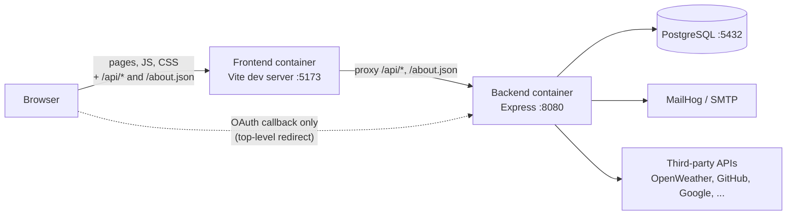
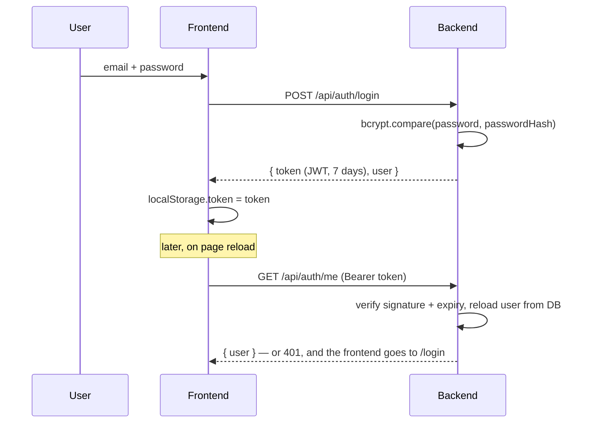
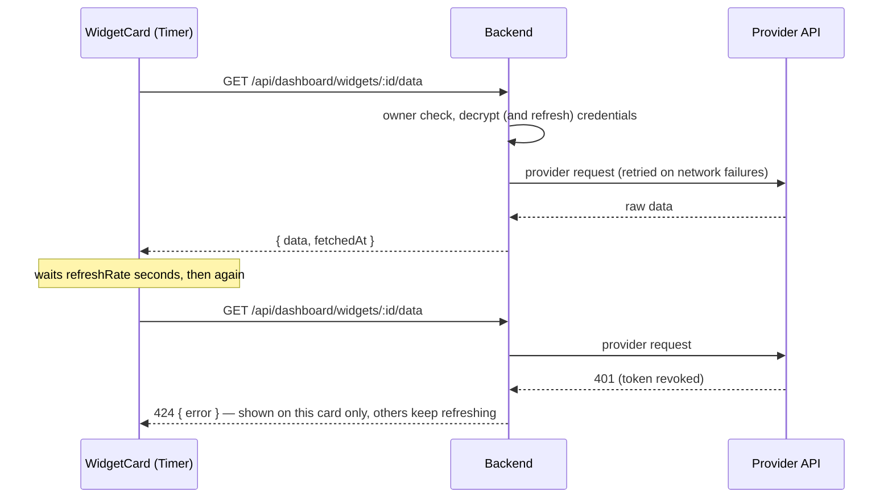

# How the frontend and the backend communicate

The frontend ([FRONTEND.md](./FRONTEND.md)) and the backend ([BACKEND.md](./BACKEND.md)) only ever
talk through a JSON REST API over HTTP. This document is the contract between them: where requests
go, how they are authenticated, what every endpoint does, how errors are signalled, and how the
main flows (session, widget refresh, OAuth2, sharing) play out end to end.

## Network path



- The browser only knows **one origin**, the frontend (`http://localhost:5173`). The Vite dev
  server serves the app and **proxies** every request to `/api/*` and `/about.json` to the
  backend (`VITE_BACKEND_URL`, `http://backend:8080` inside the Docker network). From the
  browser's point of view, API calls are same-origin: no CORS preflight, and the backend URL never
  appears in frontend code (the axios instance just uses `baseURL: '/api'`).
- The backend still restricts CORS to `FRONTEND_URL`, for setups where the frontend calls it
  directly.
- **Exception — OAuth2 callbacks.** Providers redirect the browser straight to the backend
  (`http://localhost:8080/api/services/<service>/oauth/callback`). The backend then redirects the browser back to the frontend. See
  [OAuth2](#linking-a-third-party-account-oauth2).
- **Confirmation emails** link to the frontend (`/confirm/:token`), which calls the API.

## Conventions

| Aspect          | Rule                                                                            |
| --------------- | ------------------------------------------------------------------------------- |
| Format          | JSON bodies (`Content-Type: application/json`), JSON responses                  |
| Authentication  | `Authorization: Bearer <JWT>` header, added by the axios request interceptor    |
| Token storage   | `localStorage` key `token` — no cookies, so no CSRF surface on the API          |
| Errors          | Always `{ "error": "message" }` with a meaningful status code                    |
| Ownership       | Resources are always looked up for the authenticated user; someone else's widget id is a 404 |
| Trust           | The backend re-validates everything; frontend checks are only for comfort       |

### Status codes and how the frontend reacts

| Status | Sent by the backend when...                                 | The frontend...                                     |
| ------ | ----------------------------------------------------------- | --------------------------------------------------- |
| 2xx    | Success (`201` on creation, `204` on deletion)              | Updates its state                                   |
| 400    | Invalid input                                               | Shows the `error` message next to the form          |
| 401    | The JWT is missing, invalid, expired, or its user is gone   | **Removes the token and redirects to `/login`** (global interceptor) |
| 403    | Not allowed: not admin, wrong password, unconfirmed email   | Shows the message, stays on the page                |
| 404    | Unknown resource (or not yours)                             | Shows the message                                   |
| 409    | Conflict: email taken, last admin                           | Shows the message                                   |
| 424    | The widget's provider refused (account not linked, revoked token) | Shows the message **on that widget only**      |
| 500    | Unexpected server error (details only in server logs)      | Shows a generic message                             |

The asymmetry is deliberate: because 401 means "log out", the backend never uses it for anything
else — a wrong current password is a 403 and a provider's own 401 is turned into a 424, otherwise
a mistyped password or an expired GitHub link would kick the user out of the app.

## Endpoint catalogue

`auth` = requires a valid JWT. `admin` = JWT of an admin account.

### Public

| Method & path                         | Purpose                                                             |
| ------------------------------------- | ------------------------------------------------------------------- |
| `GET /about.json`                     | Server description required by the brief (see below)                |
| `GET /health`                         | Liveness check (`{ status: "ok" }`), used by CI                     |
| `POST /api/auth/register`             | Create an account `{ email, password, name }` → 201, sends the confirmation email |
| `GET /api/auth/confirm/:token`        | Confirm an email address                                            |
| `POST /api/auth/login`                | `{ email, password }` → `{ token, user }`                            |
| `GET /api/public/dashboards/:token`   | A shared dashboard: owner name + widgets with their live data       |

### Account (`auth`)

| Method & path            | Purpose                                                                          |
| ------------------------ | -------------------------------------------------------------------------------- |
| `GET /api/auth/me`       | The current user                                                                 |
| `PATCH /api/auth/me`     | `{ name?, email?, newPassword?, currentPassword? }` → `{ user, emailChanged }`    |
| `DELETE /api/auth/me`    | `{ password }` → 204, account and all its data deleted                            |

### Services (`auth`, except the OAuth callback)

| Method & path                               | Purpose                                                     |
| ------------------------------------------- | ----------------------------------------------------------- |
| `GET /api/services`                         | Catalog + per-service `subscribed`, `requiresAuth`, `available` |
| `POST /api/services/:name/subscribe`        | Subscribe to a no-auth service (400 for an OAuth service)   |
| `DELETE /api/services/:name/subscribe`      | Unsubscribe / unlink                                        |
| `GET /api/services/:service/oauth/start`    | `{ url }` of the provider's consent page                    |
| `GET /api/services/:service/oauth/callback` | Called by the provider (no JWT); redirects to the frontend  |

### Dashboard (`auth`)

| Method & path                            | Purpose                                                            |
| ---------------------------------------- | ------------------------------------------------------------------ |
| `GET /api/dashboard/widgets`             | The user's widget instances                                        |
| `POST /api/dashboard/widgets`            | `{ serviceName, widgetName, config, refreshRate, size, position }` |
| `PATCH /api/dashboard/widgets/:id`       | Any of the above fields, including a new service/widget            |
| `DELETE /api/dashboard/widgets/:id`      | Remove a widget                                                    |
| `GET /api/dashboard/widgets/:id/data`    | Live data `{ data, fetchedAt }` — what the Timer polls             |
| `GET/POST/DELETE /api/dashboard/share`   | Read / enable / disable the public share link                      |

### Administration (`admin`)

| Method & path                  | Purpose                              |
| ------------------------------ | ------------------------------------ |
| `GET /api/admin/users`         | List users                           |
| `PATCH /api/admin/users/:id`   | `{ role: "USER" \| "ADMIN" }`         |
| `DELETE /api/admin/users/:id`  | Delete a user                        |

### `GET /about.json`

Generated live from the backend's widget registry, so it always lists exactly the services that
are installed (currently 10 services, 35 widgets — the `notes` service is left out, see its section):

```json
{
  "client": { "host": "172.24.0.1" },
  "server": {
    "current_time": 1790719273,
    "services": [
      {
        "name": "weather",
        "widgets": [
          {
            "name": "city_temperature",
            "description": "Current temperature for a city",
            "params": [{ "name": "city", "type": "string" }]
          }
        ]
      }
    ]
  }
}
```

`client.host` is the caller's IP, `current_time` the server's Unix time in seconds, and each
param's `type` is `string` or `integer`. The frontend uses this same document to build the "Add a
widget" form, so the catalog shown to users can never drift from what the server accepts.

## Main flows

### Session: login and restoring it



### Widget refresh (the Timer)

Each widget card polls its own data endpoint on its own `refreshRate`; the backend fetches fresh
data from the provider on every call.



Details: [FRONTEND.md — Refresh rate](./FRONTEND.md#refresh-rate-the-timer) and
[BACKEND.md — Refresh rate](./BACKEND.md#refresh-rate-server-side).

### Linking a third-party account (OAuth2)

1. The Services page calls `GET /api/services/github/oauth/start` with the JWT and receives
   `{ url }`.
2. The frontend navigates to that URL (a navigation can't carry the `Authorization` header, which
   is why the URL is fetched first). It contains a signed, 10-minute `state` identifying the user.
3. After consent, the provider redirects the browser to the backend callback with a `code` and the
   `state`. The backend checks the `state`, exchanges the `code` for tokens server to server,
   encrypts and stores them.
4. The backend redirects the browser to `<FRONTEND_URL>/services?linked=github` (or
   `...&error=access_denied` if the user declined). The frontend reloads the catalog, where the
   service now shows as available.

The provider tokens never reach the browser: widgets are always fetched through the backend.
Full explanation: [BACKEND.md — OAuth2](./BACKEND.md#linked-accounts-oauth2).

### Registration and email confirmation

`POST /api/auth/register` → the backend emails `<FRONTEND_URL>/confirm/<token>` → the user opens it
→ the Confirm page calls `GET /api/auth/confirm/:token` once → the account can log in. Changing the
email from the Profile page reuses the same mechanism with the new address.

### Public sharing

The owner calls `POST /api/dashboard/share` and gets a token; the link is
`<frontend>/shared/<token>`. Anyone opening it triggers a single unauthenticated
`GET /api/public/dashboards/:token`, which returns every widget with live data, computed on the
server with the owner's credentials — the visitor never receives those credentials. A widget whose
provider fails comes back with an `error` field instead of breaking the page.

## Security notes

- The JWT is kept in `localStorage`: simple and immune to CSRF (it's never sent automatically), but
  readable by any script running on the page, so the app loads no third-party JavaScript.
- Every authorization decision is made on the backend from the database (owner, role), never from
  data sent by the frontend.
- Passwords only travel in request bodies to the backend, where they are compared to a bcrypt hash;
  third-party tokens stay on the server, encrypted at rest.
- In production the whole path should run over HTTPS; locally everything is plain HTTP on
  `localhost`.
